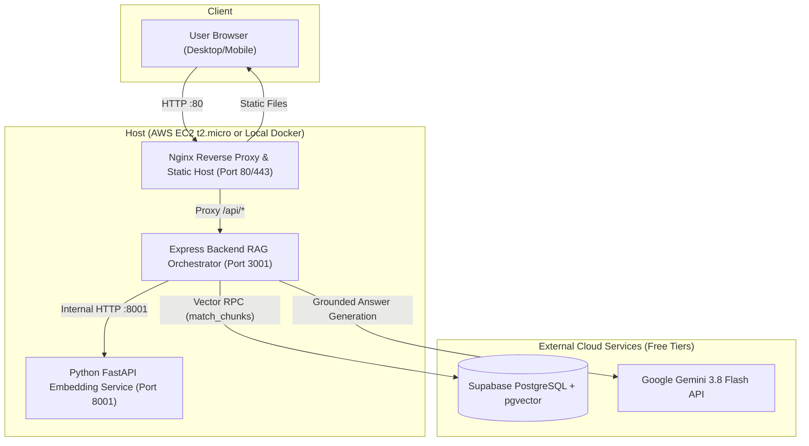

# Alchemist AI — Deployment & Cloud Operations Guide

This guide describes how to run and deploy the **Alchemist AI** reading companion locally with Docker and to the cloud on **AWS Free Tier (EC2)** from a Windows or macOS/Linux workstation.

---

## 1. Architecture Overview for Deployment



---

## 2. Resource Footprint & Free Tier Feasibility

| Component | Technology | Idle RAM | Peak RAM | Disk Space |
|---|---|---|---|---|
| **OS** | Ubuntu 24.04 LTS minimal | ~130 MB | ~160 MB | ~2.5 GB |
| **Embedding Service** | FastAPI + `all-MiniLM-L6-v2` (PyTorch CPU) | ~260 MB | ~340 MB | ~650 MB (Docker image) |
| **Backend** | Node.js 20 Express | ~65 MB | ~95 MB | ~180 MB (Docker image) |
| **Frontend & Nginx** | Nginx Alpine + Vite static bundle | ~15 MB | ~25 MB | ~35 MB (Docker image) |
| **Total Memory** | — | **~470 MB** | **~620 MB** | **< 4 GB** |

**Conclusion**: The combined stack fits within the **1.0 GB RAM** allocation of an **AWS EC2 `t2.micro` or `t3.micro`** instance. With a **2.0 GB swap file**, memory spikes (such as during container image building or initial model loading) are absorbed without crashing.

---

## 3. Option A: Local Docker Compose Setup (1-Command Run)

### Prerequisites
* Docker Desktop installed on Windows, macOS, or Linux (`docker --version`, `docker compose version`).

### Steps
1. In the project root, create your environment file:
   ```bash
   cp .env.example .env
   ```
2. Open `.env` and fill in your keys:
   ```env
   SUPABASE_URL=https://your-project.supabase.co
   SUPABASE_SERVICE_ROLE_KEY=your-supabase-service-role-key
   GEMINI_API_KEY=your-gemini-api-key
   GEMINI_MODEL=gemini-3.8-flash
   ```
3. Start the entire containerized stack:
   ```bash
   docker compose up -d --build
   ```
4. Verify all services are healthy:
   ```bash
   docker compose ps
   ```
5. Open `http://localhost` in your browser.

---

## 4. Option B: AWS EC2 Free Tier Deployment (Windows Guide)

### Step 1: Launch your EC2 Instance
1. Open the [AWS EC2 Console](https://console.aws.amazon.com/ec2/).
2. Click **Launch Instance**.
3. **Name**: `alchemist-ai-prod`
4. **AMI**: **Ubuntu Server 24.04 LTS (HVM), SSD Volume Type** (Free tier eligible).
5. **Instance Type**: `t2.micro` (or `t3.micro` depending on availability in your region).
6. **Key pair**: Create or select an existing key pair (e.g. `alchemist-key.pem`).
7. **Network settings**:
   * Create Security Group.
   * Enable **Allow SSH traffic from anywhere (`0.0.0.0/0`)**.
   * Enable **Allow HTTP traffic from the internet (`0.0.0.0/0`)**.
   * Enable **Allow HTTPS traffic from the internet (`0.0.0.0/0`)**.
8. **Storage**: Configure **30 GiB gp3** (Free Tier covers up to 30 GiB).
9. Click **Launch Instance**.

### Step 2: Connect from Windows
* **Method 1 (Browser)**: Select your instance in the EC2 Console and click **Connect** → **EC2 Instance Connect** → **Connect**.
* **Method 2 (PowerShell SSH)**:
  ```powershell
  ssh -i "path\to\alchemist-key.pem" ubuntu@<YOUR-EC2-PUBLIC-IP>
  ```

### Step 3: Configure 2GB Swap Memory
Run the following commands in the EC2 terminal:
```bash
sudo fallocate -l 2G /swapfile
sudo chmod 600 /swapfile
sudo mkswap /swapfile
sudo swapon /swapfile
echo '/swapfile none swap sw 0 0' | sudo tee -a /etc/fstab
```
*Verify swap*: `free -h` (should show `Swap: 2.0Gi`).

### Step 4: Install Docker & Docker Compose
```bash
sudo apt update && sudo apt upgrade -y
sudo apt install -y docker.io docker-compose-v2 git
sudo usermod -aG docker ubuntu
newgrp docker
```

### Step 5: Clone Repository and Configure Environment
```bash
git clone https://github.com/vedcodes2312/alchemist_rag_app.git
cd alchemist_rag_app

# Create .env file
nano .env
```
Paste your secrets into `.env`:
```env
SUPABASE_URL=https://your-project.supabase.co
SUPABASE_SERVICE_ROLE_KEY=your-supabase-service-role-key
GEMINI_API_KEY=your-gemini-api-key
GEMINI_MODEL=gemini-3.8-flash
```
Press `Ctrl + O` then `Enter` to save, then `Ctrl + X` to exit `nano`.

### Step 6: Start Application with Docker Compose
```bash
docker compose up -d --build
```
Check container logs:
```bash
docker compose logs -f
```

### Step 7: Access Your Live Application
Open your browser and navigate to:
```
http://<YOUR-EC2-PUBLIC-IP>
```

---

## 5. Domain Name and Free SSL (Optional)

If you point a domain name (e.g. `alchemist.yourdomain.com`) to your EC2 public IP:
1. Install Certbot on EC2:
   ```bash
   sudo apt install -y certbot python3-certbot-nginx
   ```
2. Generate free SSL certificates from Let's Encrypt:
   ```bash
   sudo certbot --nginx -d alchemist.yourdomain.com
   ```
3. Certbot will automatically configure HTTPS redirect and SSL certificate renewal.

---

## 6. Maintenance and Troubleshooting

* **Restart Containers**: `docker compose restart`
* **Stop Containers**: `docker compose down`
* **Rebuild after Code Update**:
  ```bash
  git pull origin main
  docker compose up -d --build
  ```
* **View Memory Usage**: `docker stats`
* **Backend Logs**: `docker logs -f alchemist-backend`
* **Embedding Logs**: `docker logs -f alchemist-embedding`
