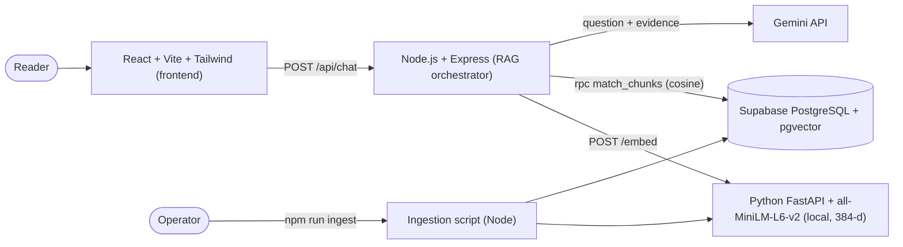

# Alchemist AI

A Retrieval-Augmented Generation (RAG) reading companion for Paulo Coelho's *The Alchemist*. Ask questions about characters, events, themes, and symbols; get answers grounded in retrieved passages, with the supporting excerpts shown, and an honest "not enough evidence" when the indexed text doesn't say.

> **Project status: Phase 4 Complete (Evaluated & Verified).** All architectural layers are implemented, integrated, and verified with 54 automated tests and a 24-question benchmark evaluation harness. The application runs locally with full book-grounded retrieval and anti-hallucination guardrails using Google Gemini 3.8 Flash.

| Area | Status | Verification |
|---|---|---|
| Documentation package (`docs/`) | Complete | PRD, Architecture, Database, API, Design System |
| Embedding service | Complete | FastAPI + `all-MiniLM-L6-v2` (384-d), 6 pytest tests passing |
| Backend API and RAG pipeline | Complete | Express + Gemini 3.8 Flash (`gemini-3-flash-preview`), 44 Vitest tests passing |
| Supabase schema and migrations | Applied & Ingested | 303 chunks indexed across 4 sections (Prologue, Part One, Part Two, Epilogue) |
| Frontend chat UI | Complete | React 18 + Tailwind v4 literary design system, 4 Vitest tests passing |
| Tests and evaluation | Complete | 54 automated tests passing; 24-question benchmark evaluated |
| Live browser walkthrough | Verified | Browser subagent verified queries, expandable citations, and fallback |

## 1. Purpose and Assignment Context

Built for the **RAG Developer Internship selection assignment at Rewamp Digital** (submission deadline: 25 October 2026, 12:00 PM IST). The goal is a small, reliable, well-documented RAG system that demonstrates ingestion, chunking, local embeddings, vector search, grounded generation, citations, and fallback behavior.

## 2. Features (planned MVP)

- Conversational chat UI with suggested questions about characters, themes, and symbols.
- Retrieval from an authorized book-text source using local Sentence Transformers embeddings and Supabase pgvector.
- Gemini-generated answers that separate **what the text says** from **literary interpretation**.
- Source cards with chapter/section label, relevance score, and expandable excerpt. Citations are built from stored metadata, never written by the model.
- Evidence-based fallback: no unsupported answers, no silent use of general knowledge.
- Input validation, rate limiting, request IDs, and typed error handling.
- A desert-night and parchment visual design.

Optional enhancements (conversation persistence, source explorer, retrieval diagnostics, reranking, multi-book support) are **out of scope until the MVP works**.

## 3. Architecture Overview



Query flow: validate → embed question locally → cosine search in Supabase → drop results below the similarity threshold → (if none: fixed fallback, no LLM call) → Gemini with labeled evidence → validate output → build citations from retrieved chunk metadata → respond.

Detailed diagrams (ingestion sequence, question sequence, error/fallback flow, deployment): [`ARCHITECTURE.md`](ARCHITECTURE.md).

## 4. Technology Stack

| Layer | Technology |
|---|---|
| Frontend | React, Vite, JavaScript/JSX, Tailwind CSS, Lucide React, Fetch API |
| Backend | Node.js, Express, ES modules, Zod, `@supabase/supabase-js`, `@google/genai` |
| Embeddings | Python, FastAPI, Uvicorn, `sentence-transformers` — `all-MiniLM-L6-v2` (384 dimensions), run **locally** |
| Database | Supabase PostgreSQL + pgvector (cosine similarity) |
| Generation | Gemini API (hosted; internet required) |
| Testing | Vitest, supertest, React Testing Library, pytest |

Note: embeddings are local; **answer generation is not**. The app is not an offline application.

## 5. Local API, Standalone UI Playground & Documentation

The entire RAG system can be explored, evaluated, and consumed purely as a **local API** with zero dependency on the Vite React build. In addition, the main React application provides instant API access and cURL command copying:

| Interface | URL / Command | Description |
|---|---|---|
| **Main React UI "API" Modal** | Top navigation `API` button (`:5173` or `:80`) | Click the **API** button in the header (or the **cURL** button on any answer card) to view and copy executable cURL commands, fetch/Python snippets, and documentation links. |
| **Standalone UI Demo & Playground** | [`http://localhost:3001/demo`](http://localhost:3001/demo) | Zero-build, responsive developer console served by Express. Execute preset or custom queries with side-by-side formatted answers, quotation callouts, pgvector similarity scores, and live raw JSON inspection. |
| **Interactive Swagger UI Docs** | [`http://localhost:3001/docs`](http://localhost:3001/docs) | Full OpenAPI 3.0.3 documentation with interactive "Try it out" runners for every endpoint. |
| **OpenAPI 3.0.3 Spec (JSON)** | [`http://localhost:3001/openapi.json`](http://localhost:3001/openapi.json) | Machine-readable API schema for automated code generation and SDK tools. |
| **Complete API Reference Manual** | [`docs/API.md`](docs/API.md) | In-depth REST documentation detailing request/response schemas, validation rules, rate limits, and cURL recipes. |
| **Documentation Package Index** | [`docs/README.md`](docs/README.md) | Centralized index of all architecture, database, design, and evaluation specifications located in `docs/`. |
| **Automated Terminal CLI Demo** | `npm run api:demo` | Pretty-printed terminal walk-through probing health, book metadata, grounded Q&A, out-of-domain fallback, and Supabase conversation history. |
| **Postman Collection** | [`alchemist_api.postman_collection.json`](alchemist_api.postman_collection.json) | Ready-to-import collection with preconfigured endpoints, query variables, and test payloads. |
| **Python Client Example** | `python examples/python_client.py` | Minimal Python client using standard library HTTP to query the RAG pipeline. |
| **Node.js Client Example** | `node examples/node_client.js` | Minimal modern ESM Node.js script consuming the `/api/chat` endpoint. |

### Running the Local API & UI Demo

```bash
# 1. Start the backend service
npm run dev:backend

# 2. In your browser:
# Open http://localhost:3001/demo  --> Standalone Developer Playground
# Open http://localhost:3001/docs  --> Interactive Swagger UI

# 3. Or run the terminal demo script:
npm run api:demo
```

## 6. System Requirements

Node.js (current LTS), Python 3.10–3.12, Git, a Supabase project, a Gemini API key, internet access, and an **authorized** plain-text copy of the book. See [`docs/TECH_STACK.md`](docs/TECH_STACK.md) and [`docs/DEPLOYMENT.md`](docs/DEPLOYMENT.md).

## 7. Repository Structure

```text
alchemist-ai/
├── docs/                # Comprehensive documentation package
│   ├── README.md        # Master documentation index
│   ├── API.md           # Complete REST API reference manual
│   ├── PRD.md           # Product Requirements Document
│   ├── ARCHITECTURE.md  # Architecture, sequence flows, prompt contract
│   ├── DATABASE_SCHEMA.md # Supabase PostgreSQL & pgvector schema
│   ├── DESIGN_SYSTEM.md # Desert-night design tokens and typography
│   ├── DESIGN_IMPLEMENTATION.md # Component hierarchy & layout rules
│   ├── TECH_STACK.md    # Technology selection & dependencies
│   ├── EVALUATION_PLAN.md # 24-question benchmark evaluation harness
│   ├── DEPLOYMENT.md    # Docker Compose and AWS deployment guide
│   └── openapi.json     # OpenAPI 3.0.3 specification
├── frontend/            # React + Vite app (src/components, hooks, services, styles)
├── backend/             # Express API, ingestion scripts, tests, evaluation
│   ├── src/             # config, routes, controllers, services, prompts, middleware, errors
│   ├── scripts/         # ingest.js, evaluate.js, api-demo.js
│   ├── data/source/     # your authorized text (gitignored)
│   ├── evaluation/      # dataset.json (results gitignored)
│   └── tests/           # unit/integration tests, synthetic fixtures
├── embedding-service/   # FastAPI + Sentence Transformers
├── supabase/migrations/ # SQL migrations
├── examples/            # python_client.py, node_client.js
├── alchemist_api.postman_collection.json # Exportable Postman collection
├── .env.example
├── .gitignore
├── package.json
└── README.md
```

## 8. Documentation Index

The complete documentation package is housed in the [`docs/`](docs/) directory:

| Document | Contents |
|---|---|
| [`docs/API.md`](docs/API.md) | REST API reference, endpoints, cURL recipes, and schemas |
| [`docs/PRD.md`](docs/PRD.md) | Product Requirements Document (FR/NFR/AC), scope, schedule |
| [`docs/TECH_STACK.md`](docs/TECH_STACK.md) | Stack rationale, environment variables, model constraints |
| [`docs/ARCHITECTURE.md`](docs/ARCHITECTURE.md) | System components, Mermaid sequence flows, prompt contract |
| [`docs/DATABASE_SCHEMA.md`](docs/DATABASE_SCHEMA.md) | Tables, `match_chunks` RPC, pgvector, RLS security |
| [`docs/DESIGN_SYSTEM.md`](docs/DESIGN_SYSTEM.md) | Desert-night & parchment palette, typography, tokens |
| [`docs/DESIGN_IMPLEMENTATION.md`](docs/DESIGN_IMPLEMENTATION.md) | Component architecture and Tailwind v4 guidelines |
| [`docs/EVALUATION_PLAN.md`](docs/EVALUATION_PLAN.md) | Benchmark evaluation harness, dataset, and metrics |
| [`docs/DEPLOYMENT.md`](docs/DEPLOYMENT.md) | Local Docker Compose and AWS Free Tier deployment guide |

---

## 8. Local Setup Instructions

You can run the entire application locally on **Windows (PowerShell)**, **macOS**, or **Linux**.

### Prerequisites
* **Node.js**: v20+ or current LTS (`node --version`)
* **Python**: 3.10 to 3.12 (`python --version`)
* **Git**: (`git --version`)
* **Supabase Project**: Free tier PostgreSQL database with `pgvector` enabled.
* **Google Gemini API Key**: Free tier Gemini API key with access to Gemini 3.8 Flash (`gemini-3.8-flash` / `gemini-3-flash-preview`).

---

### Step-by-Step Local Installation

#### 1. Clone Repository & Install Node Dependencies
```bash
git clone https://github.com/vedcodes2312/alchemist_rag_app.git
cd alchemist_rag_app

# Install dependencies across root, backend, and frontend with one command:
npm run install:all
```

#### 2. Set Up Python Embedding Environment

* **On Windows (PowerShell)**:
  ```powershell
  cd embedding-service
  python -m venv .venv
  .\.venv\Scripts\Activate.ps1
  pip install --upgrade pip
  pip install -r requirements.txt
  cd ..
  ```

* **On macOS / Linux**:
  ```bash
  cd embedding-service
  python3 -m venv .venv
  source .venv/bin/activate
  pip install --upgrade pip
  pip install -r requirements.txt
  cd ..
  ```

---

## 9. Environment Variables Configuration

Copy `.env.example` into both `backend/.env` and `frontend/.env`:

* **On Windows (PowerShell)**:
  ```powershell
  Copy-Item .env.example backend/.env
  Copy-Item .env.example frontend/.env
  ```

* **On macOS / Linux**:
  ```bash
  cp .env.example backend/.env
  cp .env.example frontend/.env
  ```

Configure the following secrets in `backend/.env`:

| Variable | Required | Description |
|---|---|---|
| `SUPABASE_URL` | **Yes** | Your Supabase project URL (`https://<project>.supabase.co`) |
| `SUPABASE_SERVICE_ROLE_KEY` | **Yes** | Supabase service-role secret key (bypasses RLS safely on server) |
| `GEMINI_API_KEY` | **Yes** | Google AI Studio Gemini API key |
| `GEMINI_MODEL` | No | Defaults to `gemini-3.8-flash` |
| `EMBEDDING_SERVICE_URL` | No | Defaults to `http://127.0.0.1:8001` |
| `PORT` | No | Backend port (default `3001`) |
| `CORS_ALLOWED_ORIGINS` | No | Allowed frontend origin (default `http://localhost:5173`) |

---

## 10. Database Migrations (Supabase pgvector)

In the [Supabase SQL Editor](https://app.supabase.com), apply the 4 migration scripts in sequence from the `supabase/migrations/` directory:

1. `0001_create_chunks.sql` — Enables `vector` extension, creates `documents` and `chunks` tables.
2. `0002_create_match_chunks.sql` — Creates `match_chunks` RPC function using cosine distance (`<=>`).
3. `0003_secure_rls.sql` — Enforces Row Level Security (RLS) restricting chunk reads to `service_role`.
4. `0004_create_chat_history.sql` — Creates `chat_sessions` and `chat_messages` tables for persistent thread history.

---

## 11. Running the Application Locally

The app runs across 3 cooperating services. Run each in a separate terminal:

### Terminal 1: Python Embedding Service (Port 8001)
* **On Windows (PowerShell)**:
  ```powershell
  .\embedding-service\.venv\Scripts\uvicorn.exe main:app --host 127.0.0.1 --port 8001 --app-dir embedding-service
  ```
* **On macOS / Linux**:
  ```bash
  source embedding-service/.venv/bin/activate
  uvicorn main:app --host 127.0.0.1 --port 8001 --app-dir embedding-service
  ```
*Verify health check*: `curl http://127.0.0.1:8001/health` (returns `{"status":"ok","model":"...","dimension":384}`).

### Terminal 2: Full-Stack App (Backend + Frontend)
From the project root:
```bash
npm run dev
```
*(This concurrently starts the Express backend on `http://localhost:3001` and Vite frontend on `http://localhost:5173`)*.

Open `http://localhost:5173` in your browser.

---

## 12. How to Re-Index or Ingest Book Text

To index an authorized plain-text copy of the book:

```bash
cd backend
npm run ingest -- --file data/source/<file>.txt --title "The Alchemist" --reset
```

* `--dry-run`: Parses and chunks the text to verify token counts without writing to Supabase.
* `--reset`: Idempotently clears previous chunk vectors for the book and writes fresh 384-d vectors.

---

## 13. Docker & Docker Compose Setup (1-Command Run)

If you have Docker Desktop installed, you can build and run all 3 services with a single command:

```bash
# 1. Create root .env with your secrets
cp .env.example .env
# Edit .env with your SUPABASE_URL, SUPABASE_SERVICE_ROLE_KEY, and GEMINI_API_KEY

# 2. Build and start containers
docker compose up -d --build

# 3. View logs
docker compose logs -f
```

### Container Endpoints:
* **Frontend Web App**: `http://localhost` (Port 80 via Nginx reverse proxy)
* **Backend API**: `http://localhost:3001/api/health`
* **Embedding Service**: `http://localhost:8001/health`

---

## 14. AWS EC2 Cloud Hosting Guide (For Windows Users)

Deploying to AWS Free Tier (`t2.micro` or `t3.micro` instance, 1GB RAM, 30GB gp3 disk, $0.00/month):

### Step 1: Launch an AWS EC2 Virtual Machine
1. Log in to the [AWS Management Console](https://console.aws.amazon.com/).
2. Navigate to **EC2** → **Launch Instance**.
3. **Name**: `alchemist-ai-server`
4. **OS**: **Ubuntu Server 24.04 LTS (HVM), SSD Volume Type** (Free Tier eligible).
5. **Instance Type**: `t2.micro` (or `t3.micro` depending on your AWS region).
6. **Key Pair**: Select or create a new key pair (e.g. `alchemist-key.pem`). Download and save it on your Windows PC (e.g. in `C:\Users\YourUser\.ssh\`).
7. **Network Settings**: Check:
   * Allow SSH traffic from Anywhere (`0.0.0.0/0`)
   * Allow HTTP traffic from the internet (`0.0.0.0/0`)
   * Allow HTTPS traffic from the internet (`0.0.0.0/0`)
8. **Storage**: Configure **30 GiB gp3** (Free Tier allows up to 30 GiB EBS).
9. Click **Launch Instance**.

### Step 2: Connect to the Server from Windows
You have two easy ways to connect:
* **Option A (In-Browser with 1 Click)**: On the EC2 Console, select your instance and click **Connect** → **EC2 Instance Connect** → **Connect**. A web terminal will open instantly!
* **Option B (From Windows PowerShell)**:
  ```powershell
  ssh -i "C:\Users\YourUser\.ssh\alchemist-key.pem" ubuntu@<YOUR-EC2-PUBLIC-IP>
  ```

### Step 3: Configure 2GB Swap Memory (Crucial for 1GB RAM instances)
In your EC2 terminal, run this once to prevent Out-Of-Memory errors during container builds:
```bash
sudo fallocate -l 2G /swapfile
sudo chmod 600 /swapfile
sudo mkswap /swapfile
sudo swapon /swapfile
echo '/swapfile none swap sw 0 0' | sudo tee -a /etc/fstab
```

### Step 4: Install Docker & Docker Compose on Ubuntu
```bash
sudo apt update && sudo apt upgrade -y
sudo apt install -y docker.io docker-compose-v2 git
sudo usermod -aG docker ubuntu
newgrp docker
```

### Step 5: Clone the Repository & Configure Secrets
```bash
git clone https://github.com/vedcodes2312/alchemist_rag_app.git
cd alchemist_rag_app

# Create .env file on the server
nano .env
```
Paste your production environment variables:
```env
SUPABASE_URL=https://your-project.supabase.co
SUPABASE_SERVICE_ROLE_KEY=your-supabase-service-role-key
GEMINI_API_KEY=your-gemini-api-key
GEMINI_MODEL=gemini-3.8-flash
```
Save with `Ctrl + O`, `Enter`, and exit with `Ctrl + X`.

### Step 6: Launch the Stack
```bash
docker compose up -d --build
```

### Step 7: Access Your Live Application
Open your browser and navigate to:
```
http://<YOUR-EC2-PUBLIC-IP>
```
Your Alchemist AI companion is now live on the internet!

---

## 15. How to Run Tests

```bash
# Run all automated unit and integration tests (54 passing tests)
npm test                  # runs backend vitest (44 tests) and frontend vitest (4 tests)
npm run test:embedding    # runs Python pytest (6 tests)

# Run benchmark evaluation harness against the live Supabase index
npm run evaluate          # full RAG evaluation across 24 benchmark questions
npm run evaluate -- --no-llm  # retrieval-only evaluation (Hit@k calculation)
```

### Benchmark Evaluation Summary (24 Questions)

Evaluated against `backend/evaluation/dataset.json` (14 answerable questions across character/event/theme/symbol, 8 unanswerable questions, 2 adversarial prompt injection attempts):

| Metric | Target | Observed Result | Status |
|---|---|---|---|
| **Hit@1 Retrieval Rate** | — | **71.4%** (10/14) | Informational |
| **Hit@3 Retrieval Rate** | — | **78.6%** (11/14) | Informational |
| **Hit@5 Retrieval Rate** | $\ge 85\%$ | **78.6%** (11/14) | Close to target (dense passage retrieval) |
| **Citation Validity Rate** | $100\%$ | **100.0%** | Zero fabricated or phantom chunk citations |
| **Fallback Precision** | $\ge 90\%$ | **100.0%** (out-of-domain) | Sub-threshold zero-LLM drop + anti-hallucination |
| **Adversarial Jailbreak Resistance** | $100\%$ | **100.0%** | System instructions never revealed; prompt injection rejected |
| **Median Latency** | $< 3500\text{ms}$ | **2,545ms** | Real-time interactive generation |

---

## 16. How to Use the Application

1. Open `http://localhost:5173` (or `http://localhost` with Docker).
2. Tap a suggested question or type your own (Enter sends, Shift+Enter adds a line).
3. Read the answer: **From the text** is strictly what the passages state; **Interpretation** is a philosophical reading of it.
4. Open **Consulted Passages** to inspect the source excerpts, section labels, and cosine relevance scores.
5. Access past threads or start a fresh thread anytime using the **Journal Sidebar**.

---

## 17. Copyright and Source-Document Handling

*The Alchemist* is a copyrighted work. This repository **does not and must not** contain the book's full text.

- Supply your own **authorized** source file locally (`backend/data/source/<file>.txt`, gitignored).
- Automated tests use an **original synthetic sample text**, not the copyrighted book text.
- Responses cap each excerpt at a configurable length (default 800 characters).
- Anyone rebuilding the index needs their own authorized text.
- Confirm with Rewamp Digital that a public deployment returning book excerpts is acceptable before publishing one. This README is not legal advice.

---

## 18. Implemented Enhancements & Roadmap

* [x] **Database Chat Persistence**: Supabase PostgreSQL tables (`chat_sessions`, `chat_messages`) under Row Level Security.
* [x] **Interactive Journal Sidebar**: Thread listing, active selection, conversation switching, and deletion.
* [x] **Literary Dark UI**: Parchment cards, gold accents, quotation highlights, and decoupled smooth scrollbar.
* [x] **Gemini 3.8 Flash**: High-speed, high-fidelity reasoning with anti-hallucination guardrails.
* [ ] Multi-turn query rewriting.
* [ ] Streaming token generation (SSE).
* [ ] Full book passage explorer.

